<p align="center">
  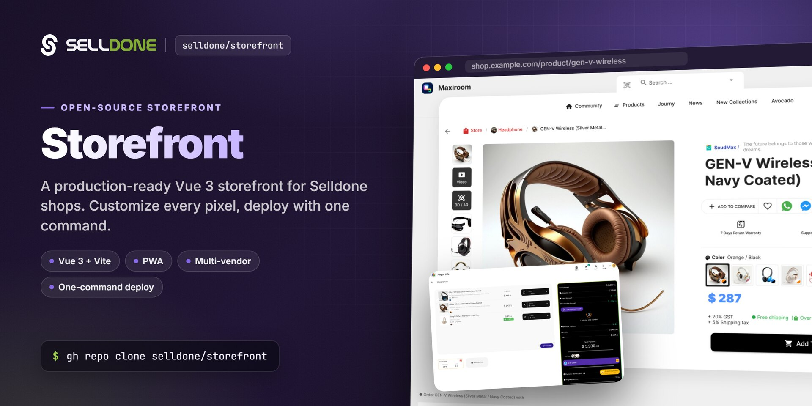
</p>

<p align="center">
  <a href="https://github.com/selldone/storefront/blob/main/LICENSE.md"></a>
  
  
  <a href="https://github.com/selldone/storefront/wiki"></a>
  <a href="https://selldone.com"></a>
  <a href="https://app.codacy.com/gh/selldone/storefront/dashboard?utm_source=gh&utm_medium=referral&utm_content=&utm_campaign=Badge_grade"></a>
</p>

<p align="center">
  <b>The official, ready-to-build Vue 3 storefront for Selldone shops. Customize every pixel, then publish it as your own Layout.</b><br>
  <a href="https://github.com/selldone/storefront/wiki">Documentation</a> ·
  <a href="#quick-start">Quick start</a> ·
  <a href="#live-preview">Live preview</a> ·
  <a href="https://github.com/selldone">Ecosystem</a> ·
  <a href="https://selldone.com">Selldone.com</a> ·
  <a href="https://github.com/selldone/storefront/issues">Report an issue</a>
</p>

<p align="center">
  <b>Storefront</b> ·
  <a href="https://github.com/selldone/pagebuilder">Page Builder</a> ·
  <a href="https://github.com/selldone/components">Components</a> ·
  <a href="https://github.com/selldone/storefront-sdk">Storefront SDK</a> ·
  <a href="https://github.com/selldone/backoffice-sdk">Backoffice SDK</a> ·
  <a href="https://github.com/selldone/vendor-sdk">Vendor SDK</a> ·
  <a href="https://github.com/selldone/community-sdk">Community SDK</a> ·
  <a href="https://github.com/selldone/core">Core</a> ·
  <a href="https://github.com/selldone/cli">CLI</a> ·
  <a href="https://github.com/selldone/translate">Translate</a>
</p>

## Overview

**Selldone Storefront** is a complete, production-ready web app for the customer side of a
[Selldone®](https://selldone.com) shop: home and landing pages, product listings with filters, product pages,
basket and checkout, customer panel, blog, community, maps and more. It is built with **Vue 3**, **Vite**,
**Vuetify** and the Selldone SDKs, and it is fully open source.

On Selldone, a custom storefront is called a **Layout**. A Layout is an independent web application that runs on
Selldone's infrastructure. Selldone deliberately replaced traditional *templates* and *plugins* (and their
instability, costs, security issues and bugs) with Layouts: you own the entire frontend, while the platform handles
products, orders, payments, shipping, taxes, customers, hosting, CDN and SSL.

Use this repository to:

- **Build a unique storefront** for your own brand, with no backend code.
- **Create Layouts for clients or niches** (influencers, restaurants, subscription boxes…) and sell them.
- **Learn the Selldone stack** end to end: Core, SDKs, Components and Page Builder working together.

### Manifesto: celebrating business uniqueness

Every business has its own story, ethos and vision. Page builders are convenient, but their templates and
predefined designs often keep a brand from shining in its full, authentic glory. That's why
[we've chosen to disrupt the status quo of e-commerce](https://selldone.com/blog/the-next-generation-of-founders-is-not-just-technical-147):
by offering pre-made, fully open-source components, businesses can tailor their digital presence down to the finest
detail, without the headaches of technical complexity. **Because in uniqueness, there's power.**

## Key features

- **Complete shopping journey:** landing pages, listings, filters, product pages, comparison, basket, checkout,
  order tracking and customer panel.
- **Every product type:** physical, virtual, file, service and subscription products, plus marketplace
  (multi-vendor) offers.
- **Conversion tools built in:** cross-selling and upselling, smart suggestions, gift shopping, coupons, offers,
  cashback and lotteries.
- **Visual pages:** landing pages, menus and popups created with the [Page Builder](https://github.com/selldone/pagebuilder)
  render automatically.
- **Global by default:** multi-language (about 100 languages via [Translate](https://github.com/selldone/translate)),
  multi-currency and RTL support.
- **PWA and native app ready:** installable web app, plus a native-app login mode.
- **Develop against real data:** run locally against any live shop, or attach your dev server to a live website.
- **One-command deploy:** publish with the [Selldone CLI](https://github.com/selldone/cli) and manage versions in
  the developer panel.
- **AI-agent ready:** an included agent kit guides AI coding assistants to redesign the storefront safely.

## Live preview

| Page | URL |
|---|---|
| Product page | https://marketplace.hanscristy.com/product/238246-gen-v-wireless-silver-metal-navy-coated |
| Landing page | https://marketplace.hanscristy.com/ |
| Product listing | https://marketplace.hanscristy.com/shop |
| Product filters | https://bigmart.me/printful-category |

## Screenshots

<table>
  <tr>
    <td width="50%"><b>Product page</b><br>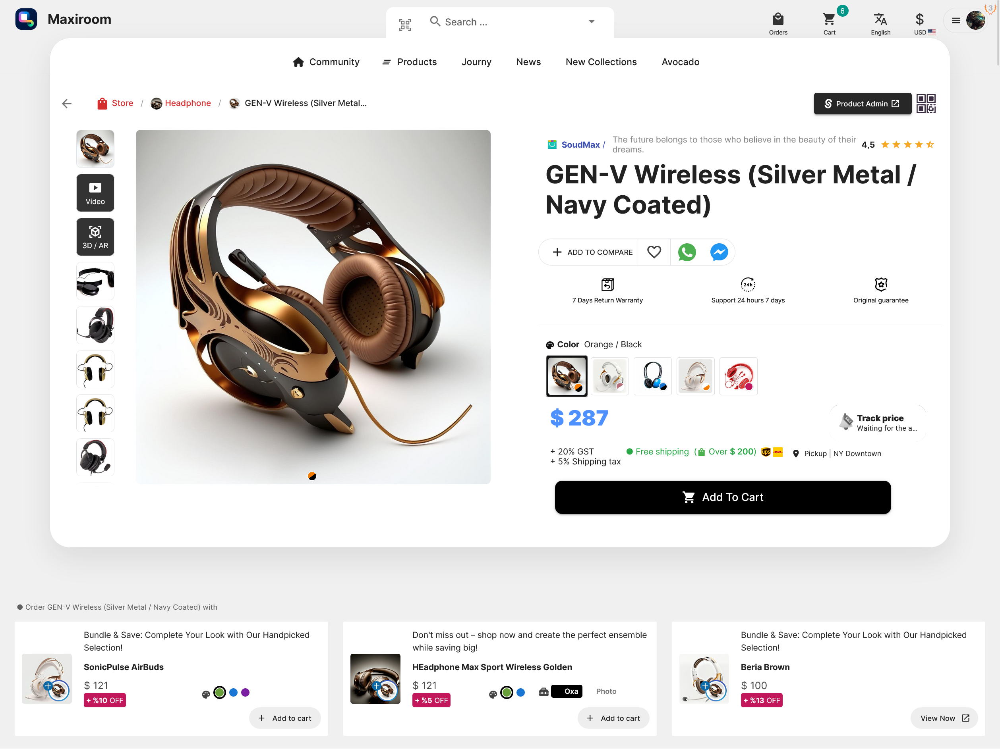</td>
    <td width="50%"><b>Checkout</b><br>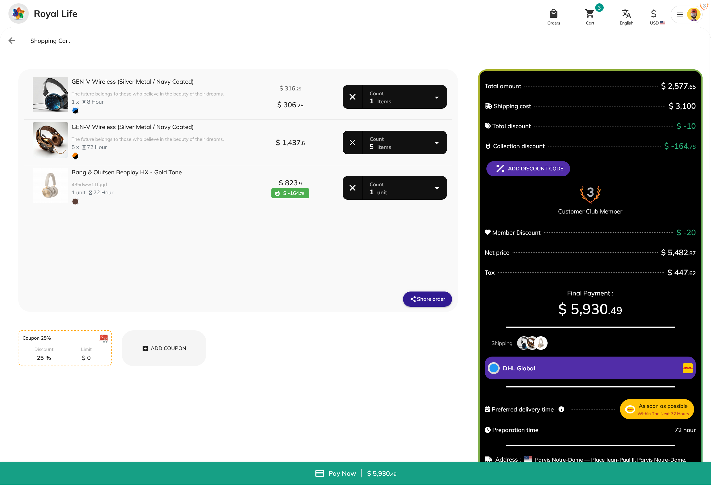</td>
  </tr>
  <tr>
    <td><b>Dynamic listing view</b><br>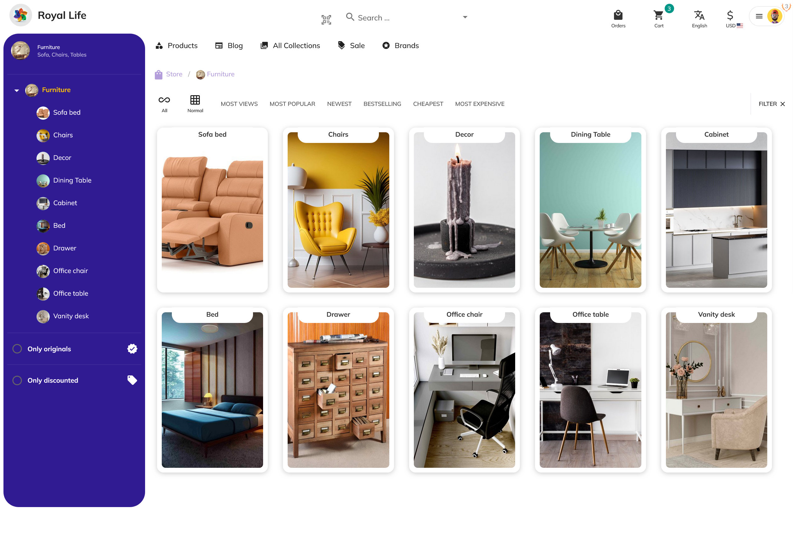</td>
    <td><b>Product filters</b><br>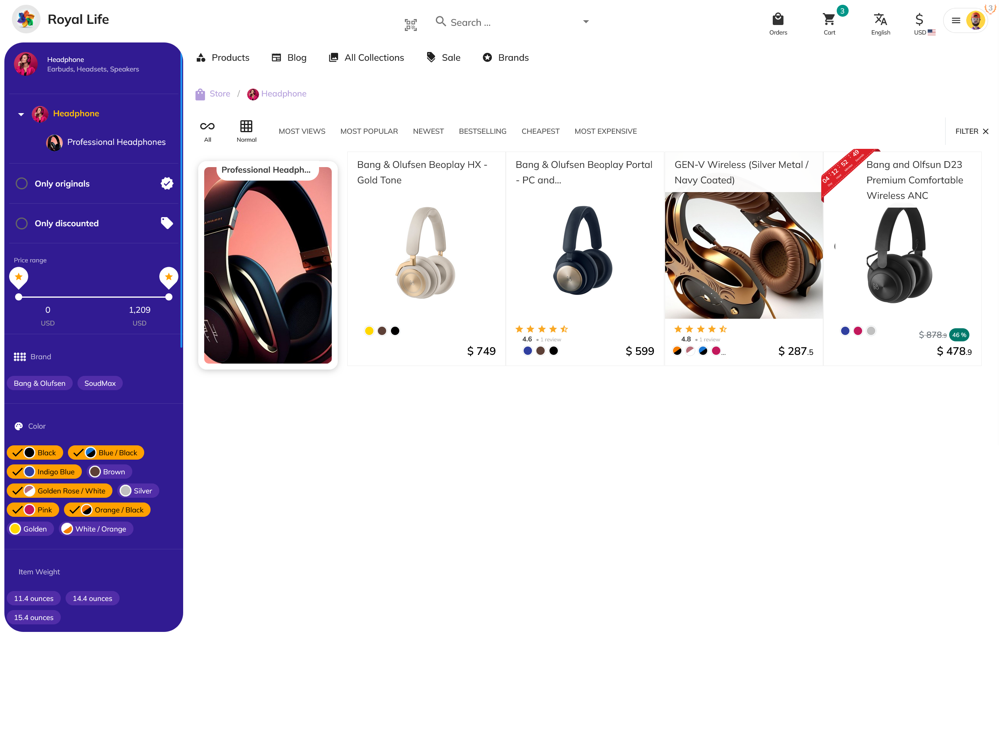</td>
  </tr>
  <tr>
    <td><b>Cross-selling and upselling</b><br>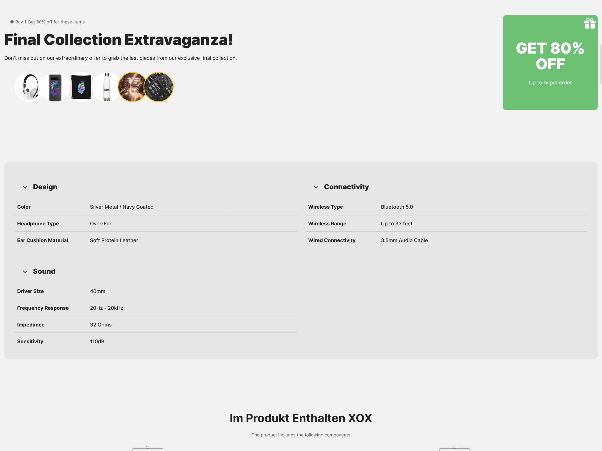</td>
    <td><b>Smart suggestions</b><br>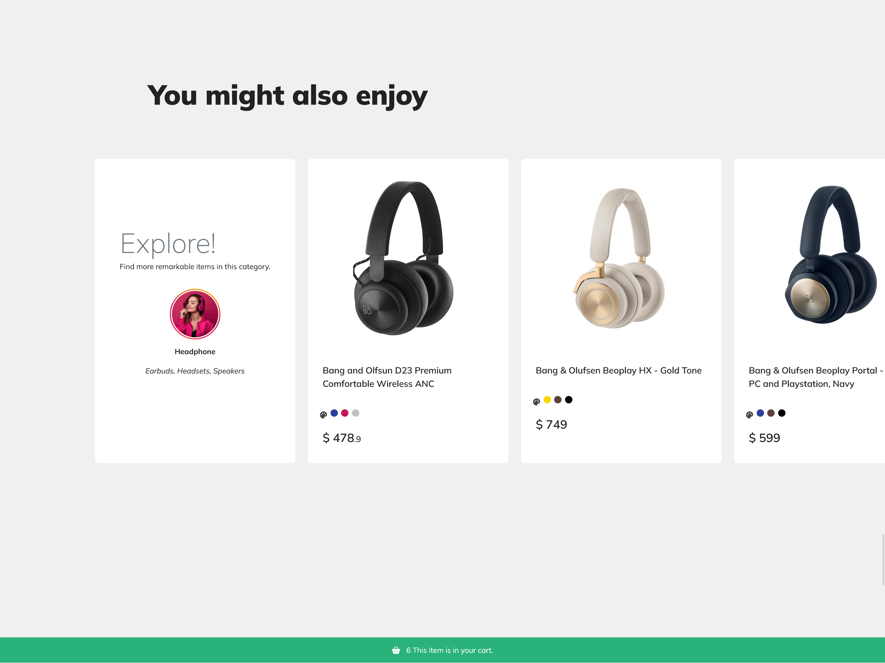</td>
  </tr>
  <tr>
    <td><b>Pickup</b><br>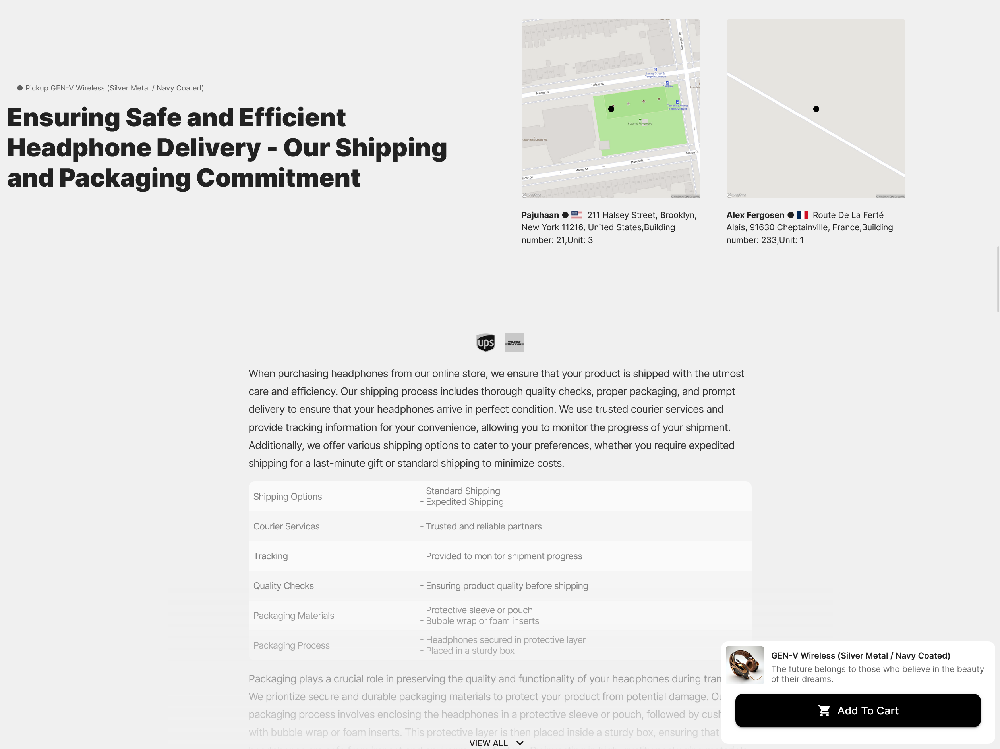</td>
    <td><b>Gift shopping</b><br>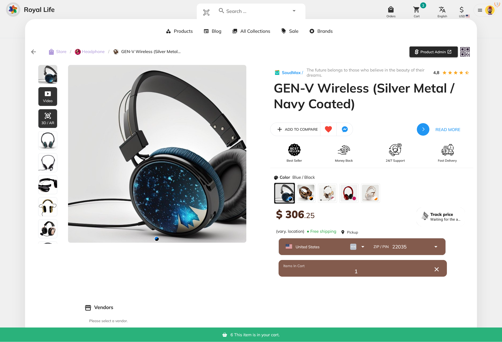</td>
  </tr>
  <tr>
    <td colspan="2"><b>Custom product layout</b><br>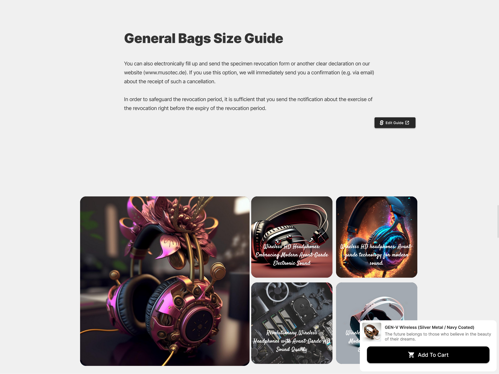</td>
  </tr>
</table>

## Quick start

> **Video guide:** [Getting started with the Storefront project](https://youtu.be/UBwjxznQz0U)
>
> [](https://youtu.be/UBwjxznQz0U)

**Prerequisites:** Node.js (LTS), Git, and npm or Yarn. New to the toolchain? See
[Setting up the development environment](https://github.com/selldone/storefront/wiki/Setting-Up-Development-Environment).

**1. Clone the project**

```shell
gh repo clone selldone/storefront
cd storefront
```

**2. Install the Selldone modules and packages**

`setup` fetches the Selldone modules from GitHub (Git submodules), then you install the remaining packages.

```shell
# Yarn
yarn setup
yarn install --force

# npm
npm run setup
npm install --force
```

**3. Start the development server**

```shell
yarn serve      # or: npm run serve
```

Open the address printed in the terminal, for example `http://localhost:8080/`. The storefront loads live data from
the sample shop configured in `.env`.

Two step-by-step articles:

- [How to develop a storefront on a live website with live updates (Vue + Vite + Selldone)](https://pajuhaan.medium.com/how-to-develop-a-storefront-on-a-live-website-with-live-updates-vue-vite-selldone-55099a330911)
- [How to develop a storefront (PWA) with Vue + Vite + Selldone and test it on your PC with live data](https://pajuhaan.medium.com/how-to-develop-a-storefront-for-your-ecommerce-pwa-with-vue-vite-selldone-and-test-it-on-your-7c0510ea33a1)

## Configuration

### Manifest (`manifest.json`)

The manifest defines your Layout when you publish it on Selldone:

```json
{
  "deploy_server": "https://layouts.selldone.com",
  "deploy_path": "",
  "package": "sample-custom-storefront",
  "name": "My Storefront",
  "version": "0.0.22",
  "storefront": true,
  "backoffice": false,
  "description": null
}
```

Use a unique `package` id for your Layout and increase `version` on every deployment.

### Test environment (`.env`)

During development the project uses data from a real Selldone shop:

| Variable | Description | Example |
|---|---|---|
| `VITE_APP_SAMPLE_SHOP_NAME` | Your Selldone shop name, in the format `my-shop-name`. | `toysworld` |
| `VITE_APP_SAMPLE_SHOP_CUSTOM_HOME` | First page of the storefront: `blog`, `avocado`, `hyper`, `community`, `shop`, `map`, a landing page ID (number), or `null`. | `3001` |
| `VITE_APP_SAMPLE_DEFAULT_CURRENCY` / `_COUNTRY` / `_LANGUAGE` | Defaults for the sample shop. | `GBP` / `GB` / `en` |
| `VITE_APP_SAMPLE_THEME_COLOR_*` | Theme colors (light, dark, deep dark, info). | `"#70557E"` |
| `VITE_APP_DEV_SERVER_HOST` / `_PORT` / `_HTTPS` | Dev server host, port and HTTPS mode. | `localhost` / `8080` / `FALSE` |

```dotenv
# ▃▃▃▃▃▃▃▃▃▃▃▃ Sample Storefront ▃▃▃▃▃▃▃▃▃▃▃▃
VITE_APP_SAMPLE_SHOP_NAME=toysworld
# Number: custom landing page number
VITE_APP_SAMPLE_SHOP_CUSTOM_HOME=3001

VITE_APP_SAMPLE_DEFAULT_CURRENCY=GBP
VITE_APP_SAMPLE_DEFAULT_COUNTRY=GB
VITE_APP_SAMPLE_DEFAULT_LANGUAGE=en

VITE_APP_SAMPLE_THEME_COLOR_LIGHT="#70557E"
VITE_APP_SAMPLE_THEME_COLOR_DARK="#000000"
VITE_APP_SAMPLE_THEME_COLOR_DEEP_DARK="#000000"
VITE_APP_SAMPLE_THEME_COLOR_INFO="#E91E63"

# ▃▃▃▃▃▃▃▃▃▃▃▃ Dev Server ▃▃▃▃▃▃▃▃▃▃▃▃
VITE_APP_DEV_SERVER_HOST=
VITE_APP_DEV_SERVER_PORT=
VITE_APP_DEV_SERVER_HTTPS=TRUE
```

The meta tags in `index.html` simulate the Selldone hosting environment (shop name, API endpoints, CDNs, defaults).
They are documented in [INDEX.md](INDEX.md) and in the wiki page
[Configuration](https://github.com/selldone/storefront/wiki/Configuration).

### Native app login

- Load the storefront in native mode with the query `?native=true`.
- Log in from a native app with `/login?app=<custom URI of the app>`.

## Deploy

Install the [Selldone CLI](https://github.com/selldone/cli) globally and run it from the project folder:

```shell
npm install -g selldone-cli
selldone
```

The CLI signs you in, builds the project, packages it and uploads it as a new version of your Layout.

[](https://www.npmjs.com/package/selldone-cli)

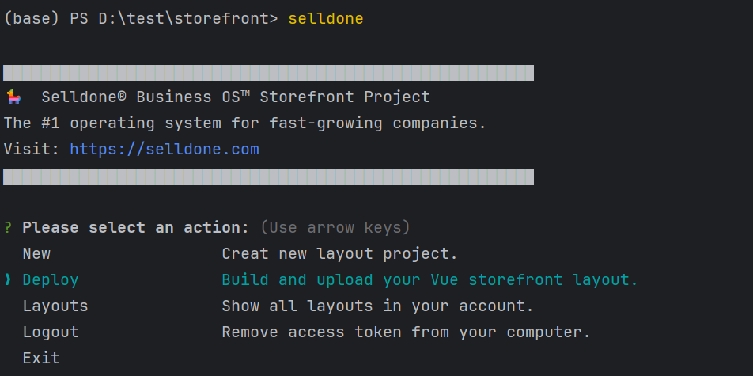

Manage your Layouts in the developer panel: **[selldone.com/developer/layouts](https://selldone.com/developer/layouts)**.
Prefer to host it yourself? See [Deploy & Hosting](https://github.com/selldone/storefront/wiki/Deploy-&-Hosting).

## Build a custom Layout with an AI agent

This repository is the standard Selldone Vue 3/Vite Storefront and the starting point for business-specific
Layouts. The AI agent kit in [`.ai-agent`](.ai-agent/README.md) is general and design-agnostic: it first turns the
merchant's business goals, audience, brand, page requirements, content and design references into an implementation
brief, then customizes this existing web app in any requested visual direction while preserving Selldone commerce
behavior.

Start with the repository [AI agent entry point](AGENTS.md) and the [Storefront Builder skill](.ai-agent/SKILL.md).
They guide discovery, design planning, implementation and regression checks against the existing Storefront. This
is not a greenfield application or framework-migration specification: visual design is flexible, while the Vue
application and its commerce contracts are the baseline.

When the requested scope also includes GitHub setup, dependency synchronization, a production build, packaging,
authentication or publication as a Selldone Layout, follow the guarded [AI workflow](.ai-agent/AI_WORKFLOW.md).
Deployment is optional, must be explicitly requested, and must be independently verified.

## Project structure

| Directory | Purpose |
|---|---|
| `components/` | Custom Vue components used by this storefront |
| `layouts/` | Master layouts that define the overall UI structure (`StorefrontLayout.vue`) |
| `pages/` | Application pages: listing, product, basket, blog, user, map, landing, POS, … |
| `router/` | Vue Router configuration |
| `store/` | Vuex store for application state |
| `lang/` | i18n language files |
| `modules/` | Selldone modules pulled in as Git submodules (core, SDKs, components, page builder, translate) |

Component prefixes: `S*` storefront, `U*` general UI, `B*` backoffice, `C*` community, `L*` landing builder.
Details: [STRUCTURE.md](STRUCTURE.md) and [Project Structure](https://github.com/selldone/storefront/wiki/Project-Structure).

## Modules

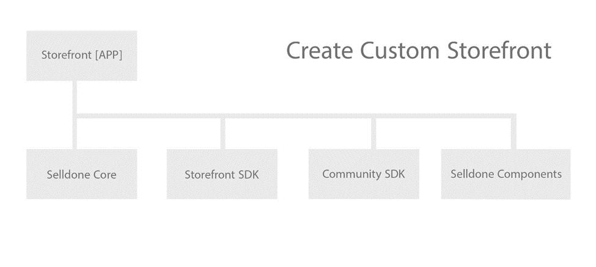

| Module | Description |
|---|---|
| [Selldone Core](https://github.com/selldone/core) | Models, types and helpers to interact with Selldone servers. |
| [Storefront SDK](https://github.com/selldone/storefront-sdk) | SDK for building and managing the storefront interface. |
| [Selldone Components](https://github.com/selldone/components) | Pre-built, professional commerce components for storefront and backoffice. |
| [Vendor SDK](https://github.com/selldone/vendor-sdk) | SDK for vendors to integrate and manage their offerings. |
| [Community SDK](https://github.com/selldone/community-sdk) | Community features: posts, topics and discussions. |
| [Selldone Page Builder](https://github.com/selldone/pagebuilder) | Build and render custom pages within the Selldone platform. |
| [Translate](https://github.com/selldone/translate) | Translation files for the shop, dashboard and backend. |

Update all modules to their latest version:

```shell
git submodule update --init --recursive --remote
```

## Backoffice: free cloud panel

Manage your business in the ready-made cloud dashboard on [selldone.com](https://selldone.com), or build a
completely bespoke management dashboard with the [Backoffice SDK](https://github.com/selldone/backoffice-sdk) and
[Components](https://github.com/selldone/components).

<table>
  <tr>
    <td width="50%"><b>Dashboard</b><br>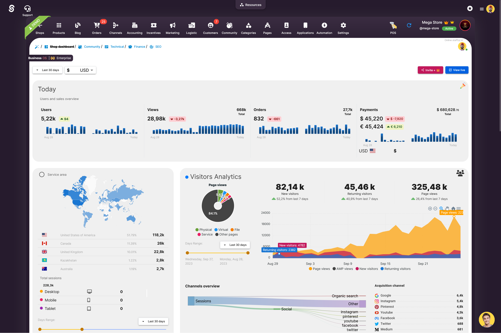</td>
    <td width="50%"><b>Products</b><br>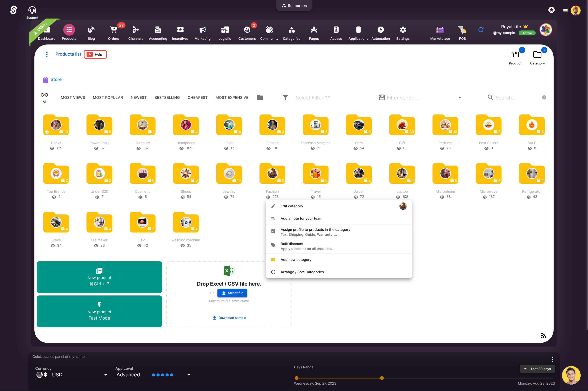</td>
  </tr>
  <tr>
    <td><b>Orders</b><br>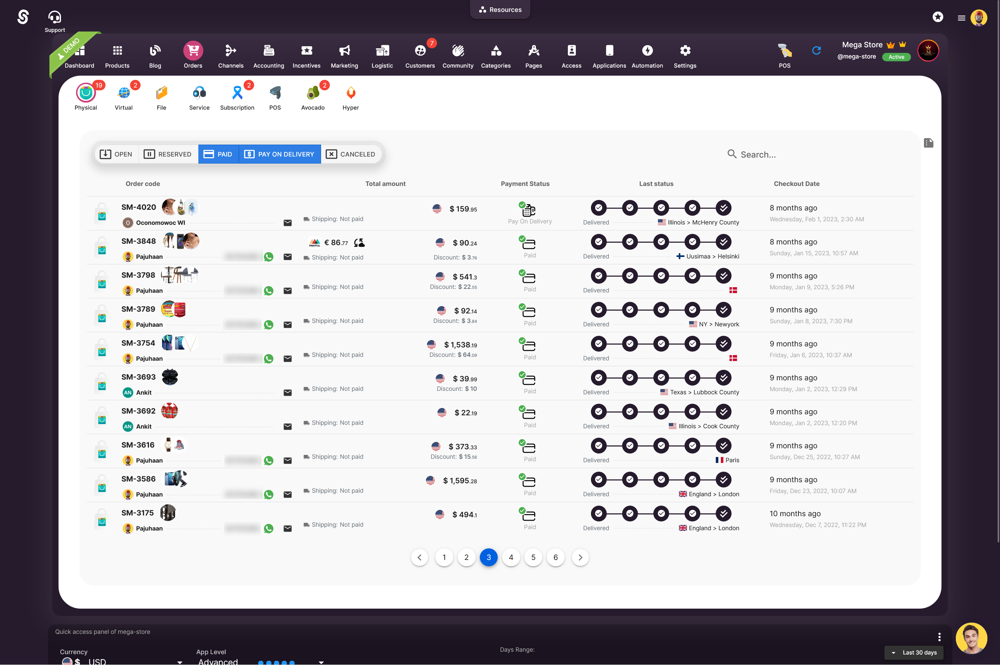</td>
    <td><b>Fulfillment</b><br>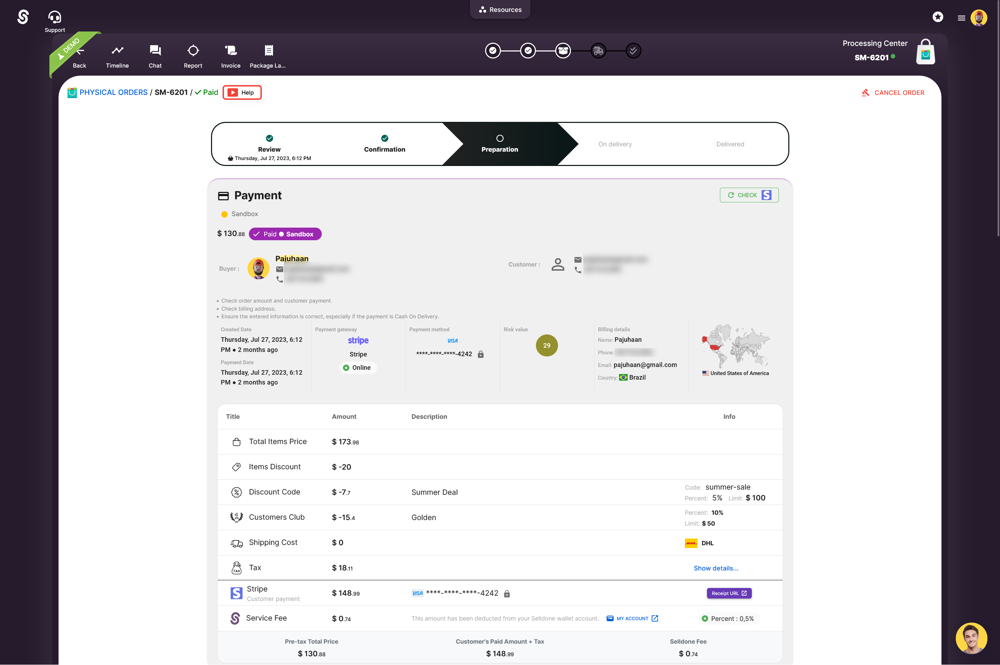</td>
  </tr>
  <tr>
    <td colspan="2"><b>Order timeline</b><br>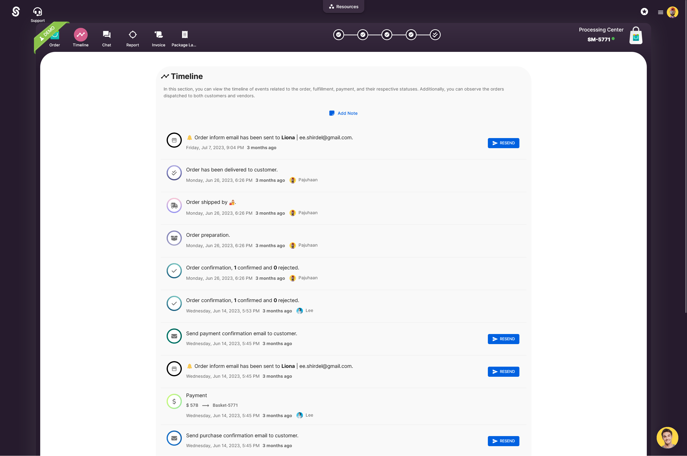</td>
  </tr>
</table>

## Monetization

Build storefronts for different verticals and publish them on Selldone, or run your own SaaS on your servers. When
you publish on Selldone, you can sell your Layouts with a one-time price or a subscription. For example, a developer
can build a storefront designed for influencers and offer it for a monthly subscription on Selldone.
Read more in [Deploy & Hosting](https://github.com/selldone/storefront/wiki/Deploy-&-Hosting).

## Roadmap

- [x] Complete components migration (Vuetify 2 → 3)
- [x] Change compiler from Vue CLI to Vite
- [ ] Publish components playground
- [ ] Publish full API & SDK docs
- [ ] Publish full Storefront docs
- [ ] Publish full Backoffice docs
- [ ] Laravel SDK to self-host the storefront
- [ ] Publish Flutter SDK

## Documentation

| Guide | What you'll learn |
|---|---|
| [Start & Build Storefront](https://github.com/selldone/storefront/wiki/Start-&-Build-Storefront) | Clone, install, run and configure the project |
| [Setting Up Development Environment](https://github.com/selldone/storefront/wiki/Setting-Up-Development-Environment) | Install Node.js and Yarn on Windows, macOS and Linux |
| [Configuration](https://github.com/selldone/storefront/wiki/Configuration) | `manifest.json`, `.env` variables and `index.html` meta tags |
| [Project Structure](https://github.com/selldone/storefront/wiki/Project-Structure) | Folders, file naming and component prefixes |
| [Develop on Live Website](https://github.com/selldone/storefront/wiki/Develop-on-Live-Website) | Attach your local dev server to a live shop |
| [Deploy & Hosting](https://github.com/selldone/storefront/wiki/Deploy-&-Hosting) | Publish with the CLI, self-host, and SaaS strategies |
| [Customize with AI Agents](https://github.com/selldone/storefront/wiki/Customize-with-AI-Agents) | Use the included agent kit to redesign the storefront |
| [Storefront Translation](https://github.com/selldone/storefront/wiki/Storefront-Translation) | Languages and how to submit corrections |
| [Hiring Guide](https://github.com/selldone/storefront/wiki/Hiring-Dev-Guide-for-Custom-Storefront-Creation-with-Vue.js-and-Selldone) | Plan, design and hire for a custom storefront |
| [FAQ](https://github.com/selldone/storefront/wiki/FAQ) | Common questions and troubleshooting |

## How it fits in the ecosystem

The Storefront is the top layer of the Selldone open-source stack. It brings the Core, the SDKs, the Components and
the Page Builder together into one ready-to-ship app, and the CLI deploys it.

<a href="https://github.com/selldone#ecosystem"></a>

| Related project | Why you'd use it |
|---|---|
| [Selldone CLI](https://github.com/selldone/cli) | Deploy this storefront to your shop |
| [Storefront SDK](https://github.com/selldone/storefront-sdk) | Build a storefront from scratch in any framework |
| [Components](https://github.com/selldone/components) | Reuse storefront and backoffice UI components |
| [Page Builder](https://github.com/selldone/pagebuilder) | Design landing pages visually |
| [Storefront Playground](https://github.com/selldone/storefront-playground) | A minimal SDK starter for learning |
| [Translate](https://github.com/selldone/translate) | Add or correct storefront translations |

## Contributing

Contributions are welcome. Please read the organization
[contributing guide](https://github.com/selldone/.github/blob/main/CONTRIBUTING.md) and the
[code of conduct](https://github.com/selldone/.github/blob/main/CODE_OF_CONDUCT.md). To work on the Selldone modules
locally together with this project, see [DEVELOPMENT.md](DEVELOPMENT.md).

## Security

Please do not report vulnerabilities in public issues. Email **security@selldone.com**.
See [SECURITY.md](SECURITY.md).

## License

See [LICENSE.md](LICENSE.md).

<details>
<summary><b>Selldone Ecosystem License Agreement</b></summary>

1. **Scope of License**: This license is granted exclusively for the use of the enclosed code (hereinafter referred to
   as "the Code") within the Selldone ecosystem. The licensee is authorized to use the Code solely in conjunction with
   services and applications that are part of, or directly related to, the Selldone ecosystem.

2. **Commercial Use Restriction**: The licensee is strictly prohibited from using the Code for any commercial purposes
   outside the Selldone ecosystem. Commercial utilization is permissible only when it is within the Selldone ecosystem
   and in accordance with the terms of this agreement.

3. **Permission for Free Use**: The Code may be used for non-commercial, free services, provided that explicit credit is
   given to Selldone. This credit must include the name "Selldone" prominently displayed on the user interface of the
   relevant service or application, along with a hyperlink to [selldone.com](https://selldone.com).

4. **No Redistribution**: The licensee may not redistribute the Code, in whole or in part, to any third party outside
   the Selldone ecosystem, unless expressly authorized by Selldone.

5. **No Modification for Redistribution**: While modifications to the Code for personal or internal use within the
   Selldone ecosystem are allowed, the licensee may not modify the Code for the purpose of redistribution outside the
   Selldone ecosystem.

6. **Termination**: Failure to comply with the terms of this agreement will result in the immediate termination of the
   license and may subject the licensee to legal action.

7. **Disclaimer of Warranty**: The Code is provided "as is" without any warranties of any kind, either expressed or
   implied, including but not limited to implied warranties of merchantability or fitness for a particular purpose.

8. **Limitation of Liability**: In no event shall Selldone be liable for any damages arising out of the use or inability
   to use the Code.

9. **Jurisdiction and Disputes**: This agreement shall be governed by the laws of the jurisdiction where Selldone is
   established. Any disputes arising from this agreement shall be resolved in the courts of that jurisdiction.

By using the Code, the licensee acknowledges that they have read, understood, and agreed to the terms of this license.

</details>

---

<p align="center"><sub>Part of the <a href="https://github.com/selldone">Selldone® Business OS</a> open-source ecosystem · <a href="https://selldone.com">selldone.com</a></sub></p>
